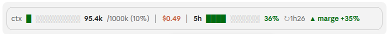

# usage-bar



Bande colorée au-dessus de la zone de saisie de Claude Code (app desktop ; devrait aussi fonctionner dans le terminal, non testé) qui affiche en direct :

- **ctx** : remplissage du contexte (tokens utilisés / taille de la fenêtre, en %) ;
- **$** : coût de la session ;
- **5h** : part de la limite de 5 heures consommée, temps avant reset, et le rythme :
  `▲ marge +8%` (vert) = tu consommes moins vite que le temps qui passe, tu peux accélérer ;
  `▼ trop vite -10%` (rouge) = tu vas atteindre la limite avant la fin de la fenêtre, ralentis.

Les jauges passent du vert à l'orange (60 %) puis au rouge (85 %). Les limites ne s'affichent
qu'avec un abonnement, après la première réponse de l'API.

## Installation

Dans une session d'un terminal :

```
/plugin install usage-bar --marketplace florent-inzerty/claude-usage-bar
```

ou depuis un shell : `claude plugin install usage-bar --marketplace florent-inzerty/claude-usage-bar`
(répondre `y` pour ajouter la marketplace, puis choisir le scope *user*).

Dans l'app desktop, où `/plugin` ne tourne pas : clic sur **+** à côté de la zone de saisie,
**Plugins**, **Add marketplace** avec `florent-inzerty/claude-usage-bar`, puis **Add plugin**.

Installé au scope *user*, le mod se charge dans toutes les sessions démarrées ensuite.

## Mise à jour

Un plugin ne voit les nouvelles versions qu'après le rafraîchissement de sa marketplace. Dans un shell, dans cet ordre :

```
claude plugin marketplace update usage-bar
claude plugin update usage-bar@usage-bar
```

Relancer ensuite la session : la nouvelle version ne se charge qu'au démarrage.
